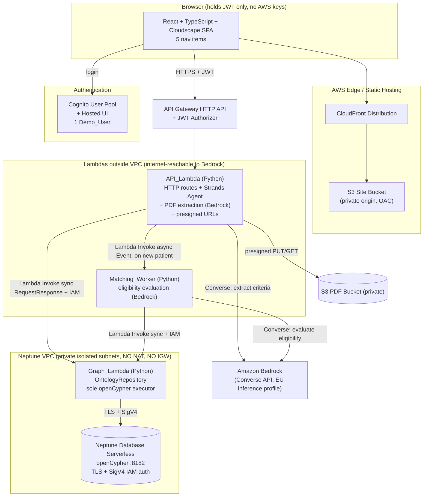
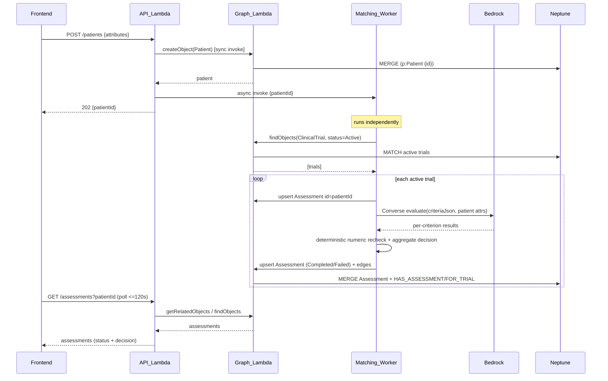
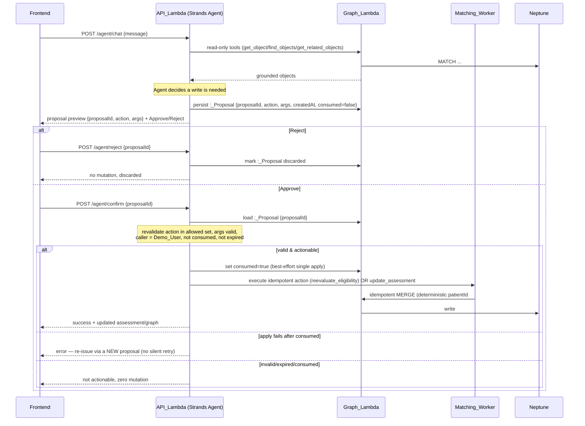

# Design Document

## Overview

This design realizes the **Ontology & Strands Agent Showcase** for the Glycurex T001 clinical-trial recruitment use case, strictly within the scope of `requirements.md` (21 requirements, SHOWCASE FIRST) and `PROJECT_SPECIFICATION.md` v1.1. It is a deliberately small but visually impressive AWS demo, not a production platform. All ten features (F01–F10) are preserved and implemented with the minimum code and infrastructure needed to deliver the five "wow moments" (PDF → ontology, patient → AI matching, live Neptune graph, chat with the ontology, agentic action).

The system is a single-page React + Cloudscape frontend backed by an API Gateway HTTP API in front of **three Python Lambdas** (API_Lambda, Graph_Lambda, Matching_Worker), with **Amazon Neptune Database Serverless** as the sole operational graph store and **Amazon Bedrock** (one configurable Claude model via an EU inference profile) for both PDF criteria extraction and eligibility evaluation. Protocol PDFs live in one private S3 bucket. The whole thing is provisioned by a single AWS CDK TypeScript project with demo-friendly removal policies.

### Design principles

- **Showcase first.** No multi-tenancy, RBAC matrices, event sourcing, workflow orchestrators, metamodel engine, or audit-node graphs. Each feature is the smallest visible working version.
- **Neptune is real.** No mock graph. Every graph read/write goes through the Graph_Lambda and the `OntologyRepository`.
- **Minimal, safe network.** Only the Graph_Lambda sits inside the Neptune VPC. API_Lambda and Matching_Worker stay outside the VPC and reach Neptune only by invoking Graph_Lambda via AWS Lambda Invoke + IAM. No NAT Gateway.
- **Writes are approval-gated.** The agent never mutates the graph directly; write actions become unexecuted proposals approved by the Demo_User and applied **at most once under normal operation** via idempotent actions plus a `consumed` flag (we do not claim distributed exactly-once).
- **Technical failures are never clinical decisions.** Any model/parse/schema error produces `processingStatus=Failed` with no `decision`.

### Key technical decisions (concrete, not open)

| Decision | Choice | Rationale (grounded in requirements) |
|---|---|---|
| Region | `eu-central-1` default (R19.8) | Default only; all resources available there. Overridable via CDK context. |
| Bedrock access | One configurable `modelId` (R18.1–18.2), defaulting to an **EU cross-region inference profile** (`eu.anthropic...`) | In eu-central-1 Claude models are reached via EU inference profiles, not single-region direct IDs. `modelId` MAY be a direct id or profile id; set as env var / CDK context. |
| Model API | **Bedrock Converse API** for both extraction and evaluation | Single API. Claude on Bedrock supports **native PDF document processing** via the Converse `document` content block: each page is rasterized to an image and combined with any extractable text, so **image-based PDFs such as T001.pdf are read directly** — no Textract/OCR pipeline (R12.2, R12.4). The extraction `document` block sets `citations: {"enabled": true}` so Claude performs full visual PDF processing and can reference source pages. |
| Frontend hosting | **S3 + CloudFront** with private S3 origin via Origin Access Control (R19.1 — choose one) | Fully CDK-managed, `cdk destroy`-friendly with `autoDeleteObjects`, no extra Amplify service, standard pattern. |
| Auth | Cognito user pool + Hosted UI, single Demo_User; JWT only in browser (R20.4–20.5) | HTTP API JWT authorizer validates the Cognito token; no AWS keys in browser. |
| Topology | Three Lambdas; only Graph_Lambda in VPC (R19.4) | Avoids NAT Gateway; keeps Neptune private. |
| Graph store | One private Neptune Database Serverless cluster, openCypher over HTTPS :8182, SigV4 IAM auth (R19.3, R20.2–20.3) | Sole operational store; IAM auth enabled; locked to Graph_Lambda SG. |
| Node types | Exactly three: Patient, ClinicalTrial, Assessment (R16.1) | No metamodel engine. |
| Agent write safety | Minimal short-lived **server-side `:_Proposal` record stored in Neptune via Graph_Lambda** (chosen over signed token) | Satisfies R15: minimal, short-lived, idempotent action + `consumed` flag + short TTL for at-most-once apply, no DynamoDB (R19.6). `:_Proposal` is a technical record, **not** one of the three business node types. |

---

## Architecture

### Component and network architecture



### The Lambda Invoke + IAM boundary

The architecture deliberately splits "needs the internet (Bedrock)" from "needs Neptune":

- **API_Lambda** and **Matching_Worker** need Bedrock (a public AWS API endpoint) and therefore stay **outside** the VPC, where they have normal internet egress with no NAT cost.
- **Graph_Lambda** needs **only** Neptune and therefore sits **inside** the VPC in private isolated subnets. It makes no external calls, so it needs no NAT Gateway and no Internet Gateway.
- The only bridge between the two zones is **AWS Lambda Invoke**: API_Lambda and Matching_Worker call Graph_Lambda with an IAM-authorized `lambda:InvokeFunction`. Neptune is never reachable from outside the VPC, from the browser, or from the public internet (R20.2).

This directly implements R19.4 and the "key network simplification" in spec §9 and removes the need for a NAT Gateway (R19.6).

### Request flows

Add patient → automatic matching (R5, A03):



Agent write proposal → approve → apply (R15, A09):



---

## Components and Interfaces

### Frontend (R3, R4, R11)

React + TypeScript + AWS Cloudscape, light theme, with exactly five navigation items and a persistent "Synthetic Demo Data – Not for Clinical Use" label (R3.1, R3.2, R3.4, R20.1):

- **Recruitment Hub** — patient table with trial dropdown, search control, status filter; `Add Patient` form; Review Patient overlay (patient data, trial criteria, AI Decision, explanation, `Modify Decision`), showing all trial Assessments for the selected patient even when the table is filtered (R4).
- **Clinical Trials** — trial cards/table, `Upload Protocol`, PDF preview next to extracted criteria, review form for missing metadata, `Activate Trial`; statuses Draft/Active/Inactive (R12, R13).
- **Ontology Explorer** — interactive graph (Cytoscape.js or React Flow) of Patient/Assessment/ClinicalTrial nodes and edges from live Neptune, click-for-details side panel, one basic filter (R11).
- **AI Agent** — chat, predefined example prompts, visible tool activity, Approve/Reject card for write proposals (R14, R15).
- **Evaluation** — `Run Evaluation`, `Patient | Trial | Expected | Actual | Pass/Fail` table, Pass Rate metric (R10).

All operations show loading states (R3.3). New-patient polling stops at 120 s and shows a non-blocking status (R5.4). The frontend holds only a Cognito JWT and attaches it as a bearer token to every API call (R20.5).

### API_Lambda (Python, outside VPC) — R14, R12, R17

Single HTTP handler (one Lambda, grouped routes — spec §10) that:

- Serves every route in R17 (see API section).
- Hosts the **one Strands Agent** (R14.1) with three read-only tools and two approval-gated write actions.
- Performs **PDF criteria extraction** via Bedrock Converse using a `document` content block (R12.2). Because Claude rasterizes each PDF page to an image and combines it with any extractable text, **image-based PDFs such as T001.pdf are extracted directly** — no Textract/OCR. A clear error is returned only for encrypted/oversized PDFs or when no usable criteria result (R12.4).
- Generates **S3 presigned URLs** for PDF upload/preview (R12.1).
- Invokes **Graph_Lambda** synchronously (`RequestResponse`) for all graph reads/writes.
- Invokes **Matching_Worker** asynchronously (`Event`) on new-patient create only (R5.2).

It never opens a Neptune connection itself and never executes Cypher.

### Graph_Lambda (Python, inside VPC) — R16, R1, R20

The **sole** executor of openCypher against Neptune. It exposes a small **typed operation envelope** rather than raw Cypher. Invocation payload:

```json
{ "operation": "getObject | findObjects | getRelatedObjects | createObject | createRelationship | upsertAssessment | saveProposal | loadProposal | consumeProposal | discardProposal | smokeTest", "params": { ... } }
```

The envelope maps to `OntologyRepository` methods. Raw Cypher is never accepted from a caller (R14.7, R18.4). Connection uses TLS + SigV4 IAM auth to the Neptune openCypher HTTPS endpoint on port 8182 (R1.2, R20.3). Its security group is the only one allowed to reach the Neptune SG on 8182.

```python
class OntologyRepository:
    def getObject(self, object_type: str, object_id: str) -> dict | None: ...
    def findObjects(self, object_type: str, filters: dict) -> list[dict]: ...
    def getRelatedObjects(self, object_id: str) -> dict:  # neighborhood: nodes + edges
        ...
    def createObject(self, object_type: str, properties: dict) -> dict: ...
    def createRelationship(self, from_id: str, edge_type: str, to_id: str) -> None: ...
    # assessment-specific create-or-update keyed by patientId#trialId
    def upsertAssessment(self, assessment: dict) -> dict: ...
```

`ALLOWED_TYPES = {"Patient", "ClinicalTrial", "Assessment"}` and allowed edge types are config-driven (R16.4). The repository validates `object_type`/`edge_type` against this config and rejects anything else. **Domain eligibility rules live outside the repository**, in Matching_Worker (R16.5). The Proposal helper operations (`saveProposal`/`loadProposal`/`consumeProposal`/`discardProposal`) persist a short-lived **`:_Proposal`** technical record described in the Agent section. `:_Proposal` is **not** one of the three business node types: it is explicitly excluded from `ALLOWED_TYPES`, from the Ontology data model, from the Ontology Explorer graph (F07), and from the neighborhood query results, so it never leaks into the domain ontology. The proposal helpers are dedicated operations, not a `createObject` type.

### Matching_Worker (Python, outside VPC) — R5, R7, R8

Async-invoked with `{patientId}`. It:

1. Reads active trials and the patient via Graph_Lambda.
2. For each active trial, upserts a `Running` Assessment (`patientId#trialId`).
3. Calls Bedrock Converse eligibility evaluation.
4. Runs the deterministic numeric recheck and decision aggregation (the domain rules).
5. Writes the completed/failed Assessment and edges via Graph_Lambda.

The same worker executes an approved `reevaluate_eligibility` action and is reused by the "Evaluate seeded patients" operation (R2.6) and `POST /evaluation/run` (R10).

### PDF criteria extraction via Bedrock Converse (R12.2, R12.4)

Extraction uses the Bedrock **Converse API** `document` content block — no Textract/OCR pipeline is added. The user message carries:

- a `document` content block with `format: "pdf"`, a `name`, the PDF **source bytes** (the object read from the S3 PDF bucket), and `citations: {"enabled": true}` — the Bedrock Converse `DocumentBlock` accepts a `citations` configuration object (per the Bedrock `CitationsConfig` API reference), and enabling it drives Claude's full visual PDF processing for image-based scans and lets Claude reference the source pages, and
- a text instruction asking the model to return structured inclusion/exclusion criteria as strict JSON.

Because Claude on Bedrock rasterizes **every PDF page to an image** and combines it with any extractable text layer, **image-based (scanned) PDFs such as `T001.pdf` are processed directly** from their visual content. This native PDF + document support is generally available on Bedrock (announced 2025-06-30).

Concrete constraints documented for the demo:

- the PDF must be **standard / unencrypted** (no password protection);
- the Bedrock document-path request payload limit is **~32 MB**, with a bounded number of pages per request;
- dense or heavy-graphics scans may reduce extraction accuracy.

`T001.pdf` is **an image-based (scanned) PDF — a full-page rasterized image with no text layer** (direct inspection shows a large image XObject at 4250×5500 with `/Subtype /Image` and no extractable text). The provided `T001.pdf` renders as a single full-page image; the exact page count is to be confirmed at the integration milestone. It is well within the Bedrock size limits and is supported via the visual `document`-block path with citations enabled.

> **Verify before claim:** the actual image-based extraction of `T001.pdf` must be confirmed during the Neptune/Bedrock integration milestone before the demo relies on it. We treat native image-based extraction as expected-to-work and validate it empirically rather than assuming it.

### Seed mechanism (R2)

Seeding uses a **dedicated internal seed path that is explicitly separate from `POST /patients`**, so the normal "new patient always matches" contract (R5) is never weakened by an overloaded flag. There are three distinct operations:

1. **Seed (create nodes, no matching).** A **local `/seed` script run by the presenter** (not a deploy-time custom resource, so deploys stay cheap and seeding is explicit). The script authenticates as the Demo_User and writes T001 + the 42 `patients.csv` patients by driving **Graph_Lambda's `createObject` path directly** (via a thin admin/seed route that is clearly separate from `POST /patients` and does **not** fan out to Matching_Worker). It idempotently `MERGE`s each node, setting `synthetic=true` and a creation-time `createdAt` (R2.1–2.3). It does **not** trigger matching (R2.5). Re-running creates no duplicates (R2.4, R2.7) and adding further patients afterwards is unaffected (R2.8).
2. **`POST /patients` (create node + auto match).** Semantics are **unchanged**: every new patient added through the Recruitment Hub creates a Patient node and asynchronously invokes Matching_Worker (R5). This path is never used for seeding.
3. **"Evaluate seeded patients" (explicit batch matching).** A separate on-demand operation (exposed as a seed-script flag / admin action) that fans out `reevaluate` per already-seeded patient. This is the **only** way seeded patients get assessed, and it is distinct from the automatic matching on `POST /patients` (R2.6).

In short: **seeding = create nodes, no matching; `POST /patients` = create node + auto match; "Evaluate seeded patients" = explicit batch matching for already-seeded patients.** The three paths do not contradict each other.

---

## Data Models

Exactly three node types (R16.1), properties from the Glossary and spec §4.

### Nodes

**Patient** — `id`, `name`, eleven clinical attributes, `synthetic=true`, `createdAt` (ISO-8601). The eleven attributes map to `patients.csv` columns (`id` and `name` are separate identity fields, not part of the eleven):

`gender, age, diagnosis, disease_stage, treatment_history, health_status, lab_results, pregnancy_status, contraception, informed_consent, lifestyle_factors`.

**ClinicalTrial** — `id`, `name`, `status` (Draft/Active/Inactive), `criteriaSummary`, `criteriaJson` (JSON string), `protocolS3Key`, `protocolVersion`, plus optional detail fields.

**Assessment** — `id` (`patientId#trialId`), `patientId`, `trialId`, `processingStatus` (Pending/Running/Completed/Failed), `decision`, `reasoning`, `criterionResultsJson` (JSON string), `previousResultsJson` (JSON string, compact history — R16.7), `reviewReason`, `reviewedDecision`, `modelId`, `evaluatedAt`, `evaluatedProtocolVersion`, `updatedAt`.

Complex data (`criteriaJson`, `criterionResultsJson`, `previousResultsJson`) is stored as **JSON-string properties** and deserialized in API responses (R16.6). No second persistence layer.

> **Excluded from the data model:** the agent-approval `:_Proposal` record is a transient **technical/infrastructure** node, not a business node type. It is not in the three-node ontology, not in `ALLOWED_TYPES`, not rendered in the Ontology Explorer, and not returned by the neighborhood query. It is described only in the Strands Agent & Approval section.

### Edges (R16.2)

```cypher
(:Patient)-[:HAS_ASSESSMENT]->(:Assessment)-[:FOR_TRIAL]->(:ClinicalTrial)
```

### Deterministic assessment id & create-or-update (R16.3, R5.5)

This is **Neptune openCypher** (no APOC, no Gremlin-only constructs) and will be validated in the Phase 0 / data-model integration milestone:

```cypher
// Upsert the single current Assessment for a patient/trial pair.
// previousResultsJson is computed entirely in Python and passed as a parameter (R16.7).
MATCH (p:Patient {id: $patientId})
MATCH (t:ClinicalTrial {id: $trialId})
MERGE (a:Assessment {id: $patientId + '#' + $trialId})
  ON CREATE SET a.patientId = $patientId, a.trialId = $trialId
SET a.previousResultsJson = $previousResultsJson,
    a.processingStatus = $processingStatus,
    a.decision = $decision,
    a.reasoning = $reasoning,
    a.criterionResultsJson = $criterionResultsJson,
    a.modelId = $modelId,
    a.evaluatedAt = $evaluatedAt,
    a.evaluatedProtocolVersion = $protocolVersion,
    a.updatedAt = $updatedAt
MERGE (p)-[:HAS_ASSESSMENT]->(a)
MERGE (a)-[:FOR_TRIAL]->(t)
RETURN a
```

History compaction (`previousResultsJson`) is computed in Python application code (the worker reads the current Assessment, builds the compact previous-result string, and passes it as `$previousResultsJson`) — Neptune openCypher has no APOC, so no in-query history logic is used. The `MERGE` on the deterministic id (`$patientId + '#' + $trialId`, string concatenation which Neptune supports) guarantees at most one current Assessment per patient/trial regardless of how many times matching runs.

### Neighborhood query (R11, R17.7 `GET /graph/neighborhood`)

This is **Neptune openCypher** (MATCH / OPTIONAL MATCH / WHERE / collect / DISTINCT with label predicates only) and will be validated in the Phase 0 / data-model integration milestone. The label predicates restrict results to the three business node types, so the technical `:_Proposal` record can never appear in the Explorer:

```cypher
MATCH (o {id: $objectId})
WHERE o:Patient OR o:ClinicalTrial OR o:Assessment
OPTIONAL MATCH (o)-[r1]-(n1)
WHERE n1:Patient OR n1:ClinicalTrial OR n1:Assessment
OPTIONAL MATCH (n1)-[r2]-(n2)
WHERE n2:Patient OR n2:ClinicalTrial OR n2:Assessment
RETURN o, collect(DISTINCT n1) AS firstHop,
       collect(DISTINCT r1) AS edges1,
       collect(DISTINCT n2) AS secondHop,
       collect(DISTINCT r2) AS edges2
```

### Seed upsert (idempotent — R2.4/2.7)

This is **Neptune openCypher** (`MERGE`, `ON CREATE SET`, and `p += $attributes` property-map assignment, all Neptune-supported) and will be validated in the Phase 0 / data-model integration milestone. The seed path drives these writes through Graph_Lambda's `createObject` and does **not** invoke Matching_Worker (R2.5):

```cypher
MERGE (t:ClinicalTrial {id: 'T001'})
  ON CREATE SET t.name = $name, t.status = 'Active', t.criteriaJson = $criteriaJson,
                t.protocolS3Key = $key, t.protocolVersion = $version, t.criteriaSummary = $summary
// per patient
MERGE (p:Patient {id: $id})
  ON CREATE SET p += $attributes, p.synthetic = true, p.createdAt = $createdAt
```

---

## Error Handling

A few clear error cases are sufficient (spec §11); no enterprise alerting.

| Failure | Handling | Requirement |
|---|---|---|
| Neptune unreachable / IAM auth fails | Graph_Lambda returns a descriptive connectivity error; API surfaces "graph unavailable" | R1.4 |
| Bedrock model/parse/schema error during evaluation | Assessment set to `processingStatus=Failed`, **no** `decision` assigned | R7.14, R8.1–8.3 |
| Bedrock output not matching structured schema | Treated as `Failed`; strict JSON-schema validation before use | R8.3, R18.3 |
| PDF encrypted/password-protected, over Bedrock size/page limits, or yielding no usable criteria | Clear error returned; **no** OCR/Textract pipeline added. (Image-based PDFs are handled natively by Claude's Converse `document` block, so a scan alone is **not** an error.) | R12.4 |
| Missing/ambiguous clinical attribute | Corresponding criterion recorded `UNKNOWN` (never assumed satisfied) | R7.3, R7.11 |
| Approved proposal fails server-side validation | No mutation; error message indicating the validation failure | R15.7 |
| Approval of consumed/discarded/expired proposal | No mutation; "no longer actionable" message | R15.9 |
| Assessment not Completed/Failed within 120 s | Frontend stops polling, shows non-blocking status | R5.4 |
| Human override with empty explanation | Rejected; non-empty explanation required before save | R9.1 |

Untrusted input: uploaded PDFs and prompt/model content are never used to execute external commands or model-generated Cypher (R18.4); the agent has no raw-Cypher tool (R14.7).

---

## Testing Strategy

A focused, **showcase-first** approach: a small set of unit tests over the pure deterministic core, a couple of essential Neptune integration tests, and end-to-end demo acceptance checks. No formal property-based-testing framework and no iteration-count mandates — just targeted assertions of the invariants that matter. No fabricated accuracy numbers (A10, spec §12).

### Key invariants (asserted by the unit tests)

These are plain invariants the unit tests assert, not a property-based-testing suite:

- **Deterministic id uniqueness** — any number of matching/re-evaluation runs for a `patientId#trialId` pair leaves exactly one current Assessment.
- **Seed idempotency** — repeated seed runs leave exactly one T001 and exactly 42 Seeded_Patients, no duplicates.
- **Decision aggregation rules** — any applicable `NOT_MET` ⇒ `Not suitable`; else any required `UNKNOWN` ⇒ `Manual review required`; else (all applicable `MET`/`NOT_APPLICABLE`) ⇒ `Suitable`.
- **Failed never carries a decision** — a technical/model/parse/schema error ⇒ `processingStatus=Failed` with no `decision`.
- **Approve-at-most-once** — a valid proposal applies its action at most once under normal operation (idempotent action + `consumed` flag); reject/expired/consumed ⇒ no mutation.
- **Override preserves AI decision** — saving a human override stores `reviewedDecision` + non-empty `reviewReason` while the original AI `decision` stays retrievable.
- **JSON round-trip** — serialize → store → deserialize yields a value equal to the original.

### Focused unit tests (pure deterministic core)

- **Decision aggregator**, including boundary cases: HbA1c 6.9% → `Not suitable` (P018); missing eGFR with no other violation → `Manual review required`.
- **Numeric parsers** for age, HbA1c, eGFR, and metformin duration against representative `lab_results`/`treatment_history` strings (e.g. `"HbA1c: 8.0%, eGFR: 65"`, `"Metformin (2 months)"`), returning `UNKNOWN` when a value is missing/ambiguous.
- **JSON serialize/deserialize round-trip** for `criteriaJson`/`criterionResultsJson`/`previousResultsJson`.
- **Proposal lifecycle guard**: approve-once; rejected/expired/consumed → no mutation.

### Essential Neptune integration tests

- **Phase 0 real openCypher write/read smoke test** (R1, gating): Graph_Lambda writes a unique node via openCypher, reads it back over TLS + SigV4 IAM, asserts equality, best-effort deletes it. This gates all business logic.
- **Create-or-update determinism**: re-running matching for the same pair keeps exactly one current Assessment per `patientId#trialId`.

### End-to-end demo acceptance checks

End-to-end checks mapping to **A01–A11**, including one PDF-extraction run against the real image-based `T001.pdf` (confirming native Converse `document` extraction — the verify-before-claim step).

### Labeled evaluation suite (R10 / A10) — ≥ 6 cases spanning all three classes, derived from real `patients.csv` rows

| Patient | CSV values (key fields) | Reason | Expected |
|---|---|---|---|
| P018 | age 51, T2DM, HbA1c 6.9%, eGFR 80, Metformin (7 mo), consent Yes, Male | HbA1c below the 7.0 inclusive bound | Not suitable |
| P011 | age 50, Type 1 Diabetes Mellitus, Insulin (5 yrs) | Exclusion: Type 1 + insulin | Not suitable |
| P014 | age 35, T2DM, HbA1c 8.0%, eGFR 50, Metformin (8 mo) | eGFR < 60 | Not suitable |
| P033 | age 36, T2DM, HbA1c 8.0%, eGFR 70, Metformin (8 mo), pregnancy Positive | Exclusion: pregnancy | Not suitable |
| P001 | age 45, T2DM, HbA1c 8.0%, eGFR 65, Metformin (3+ mo), consent Yes, Male (pregnancy N/A, contraception N/A) | All applicable criteria met; contraception/pregnancy are `NOT_APPLICABLE` for a male patient | Suitable |
| P086 | age 45, Type 2 Diabetes, HbA1c 7.5%, **no eGFR value**, consent Yes | eGFR absent ⇒ eGFR criterion `UNKNOWN`, no other definite violation | Manual review required |

**Assumption stated explicitly:** for the P001 `Suitable` label, the childbearing-related criteria (contraception and negative pregnancy test) are treated as `NOT_APPLICABLE` for a male patient. The design evaluates those two criteria as `NOT_APPLICABLE` for male patients rather than `UNKNOWN` or `NOT_MET`.

**Manual-review case note:** no seeded patient has a *cleanly* missing eGFR as its only issue. P086 (and similarly P080) are T2DM rows with HbA1c present and no eGFR listed and no other definite T001 disqualifier (they carry ECOG/alcohol lifestyle noise but nothing that violates T001). P086 is used as the `Manual review required` example because eGFR is absent, so the eGFR criterion is `UNKNOWN`.

**Honesty statement:** these six labels are **derived** from the CSV values against the stated T001 rule interpretation; they are **not** a clinically validated gold standard, and the 42 Seeded_Patients are **not** a validated test set (R10.4). The Showcase does not claim clinical validation. The Evaluation view shows Patient/Trial/Expected/Actual/Pass-Fail and a Pass Rate (R10.2, R10.3).

---

## Eligibility Algorithm (hybrid LLM + deterministic)

Grounded in R7 and spec §5. The LLM returns per-criterion results against the **approved** trial `criteriaJson`; Python deterministically rechecks unambiguous numeric limits; aggregation produces exactly one of three decisions.

### Per-criterion step (Bedrock Converse)

For each criterion in the approved `criteriaJson`, the model returns `MET | NOT_MET | UNKNOWN | NOT_APPLICABLE` plus brief evidence (R7.1). Output is validated against a strict JSON schema before use (R18.3); failure → `Failed` (R8.3).

### Deterministic numeric recheck (R7.2)

Parsed from `lab_results` / `treatment_history` / `age` only when unambiguous; otherwise `UNKNOWN` (R7.3):

- age 30–70 inclusive
- HbA1c 7.0–10.0 inclusive
- eGFR ≥ 60
- metformin stable dose ≥ 3 months

### Decision aggregation (R7.4–7.8) — pseudocode

```text
results = merge(llm_results, deterministic_rechecks)   # deterministic overrides LLM on numeric limits
applicable = [r for r in results if r != NOT_APPLICABLE]

if any(r == NOT_MET for r in applicable):
    decision = "Not suitable"
elif any(r == UNKNOWN for r in applicable):
    decision = "Manual review required"
else:   # all applicable are MET
    decision = "Suitable"
```

Boundary cases are explicit: HbA1c 6.9% → below inclusive 7.0 → `NOT_MET` → `Not suitable` (R7.7); missing eGFR with no other definite violation → `UNKNOWN` → `Manual review required` (R7.8). A technical/parse/schema error short-circuits to `processingStatus=Failed` with **no** decision (R7.14, R8).

---

## HTTP API Surface (R17)

All routes sit behind the HTTP API JWT authorizer (except `GET /health`). Grouped in one API_Lambda (spec §10).

| Endpoint | Services via | Notes |
|---|---|---|
| `GET /health` | API_Lambda | liveness, no auth |
| `GET /patients` / `GET /patients/{id}` | API_Lambda → Graph_Lambda `findObjects`/`getObject` | list/detail |
| `POST /patients` | API_Lambda → Graph `createObject` → async invoke Worker | triggers matching (R5) |
| `GET /trials` / `GET /trials/{id}` | API_Lambda → Graph | list/detail |
| `POST /trials/upload` | API_Lambda → S3 presigned PUT | returns `protocolS3Key` + upload URL |
| `POST /trials/extract` | API_Lambda → Bedrock Converse `document` block | returns structured criteria; handles image-based PDFs natively; error only if encrypted/oversized/no usable criteria (R12.4) |
| `POST /trials/{id}/activate` | API_Lambda → Graph | Draft → Active, no retroactive matching (R13.3) |
| `GET /assessments?patientId=&trialId=` | API_Lambda → Graph | deserializes JSON props |
| `POST /assessments/{id}/review` | API_Lambda → Graph | human override, non-empty reason (R9) |
| `GET /graph/neighborhood?objectId=` | API_Lambda → Graph `getRelatedObjects` | nodes + edges for Explorer |
| `POST /agent/chat` | API_Lambda (Strands) → Graph read tools | may return a proposal preview |
| `POST /agent/confirm` | API_Lambda → validate → Worker/Graph | idempotent apply, mark consumed |
| `POST /agent/reject` | API_Lambda → Graph | discard proposal, no mutation |
| `POST /evaluation/run` | API_Lambda → Worker over labeled set | returns Expected/Actual/Pass + Pass Rate |

Representative shapes:

```jsonc
// POST /patients
{ "name": "Test Patient", "gender": "Female", "age": 52, "diagnosis": "Type 2 Diabetes Mellitus",
  "disease_stage": "Stable", "treatment_history": "Metformin (6 months)", "health_status": "Good",
  "lab_results": "HbA1c: 8.0%, eGFR: 65", "pregnancy_status": "Negative", "contraception": "Yes",
  "informed_consent": "Yes", "lifestyle_factors": "Non-smoker" }
// -> 202 { "patientId": "P100", "matching": "started" }

// POST /trials/extract
{ "protocolS3Key": "protocols/abc.pdf" }
// -> { "name": "...", "summary": "...", "criteria": [ { "id": "age", "type": "inclusion", "operator": "between", "min": 30, "max": 70 } ] }

// POST /assessments/{id}/review
{ "reviewedDecision": "Suitable", "reviewReason": "Clinician confirmed eGFR from new lab." }
// -> { "id": "P018#T001", "decision": "Not suitable", "reviewedDecision": "Suitable", "reviewReason": "..." }

// POST /agent/chat
{ "message": "Re-evaluate patient P018 for trial T001." }
// -> { "reply": "...", "toolActivity": [...], "proposal": { "proposalId": "uuid", "action": "reevaluate_eligibility", "args": { "patient_id": "P018", "trial_id": "T001" } } }

// POST /agent/confirm  { "proposalId": "uuid" }  -> { "status": "applied", "assessment": {...} }
// POST /agent/reject   { "proposalId": "uuid" }  -> { "status": "discarded" }

// POST /evaluation/run -> { "passRate": 0.83, "cases": [ { "patient": "P018", "trial": "T001", "expected": "Not suitable", "actual": "Not suitable", "pass": true } ] }
```

---

## Strands Agent & Approval Store (R14, R15)

One Strands Agent in API_Lambda (R14.1) with:

- **Three read-only tools** (R14.2): `get_object(object_type, object_id)`, `find_objects(object_type, filters)`, `get_related_objects(object_id)` — each calls Graph_Lambda. The agent grounds every answer in retrieved objects (R14.3); tool activity is surfaced to the UI (R14.4).
- **Two write actions** (R15.1): `reevaluate_eligibility(patient_id, trial_id)` and `update_assessment(assessment_id, decision, reason)`. These **do not mutate directly** — they produce an unexecuted proposal with a unique `proposalId` and concrete args (R15.2).

No `CreatePatient` tool (R14.6); no raw-Cypher tool (R14.7).

### Proposal store choice: short-lived Neptune `:_Proposal` record (option a), not a signed token (option b)

Both options were evaluated against R15 (minimal, short-lived, idempotent, at-most-once apply, no DynamoDB):

- **Option (b) signed expiring token** carries the validated intent and relies on an idempotency guard for single apply. But the spec explicitly notes a signed token *alone* does not guarantee single execution (spec §8); it still needs a server-side consumed marker, so it does not actually remove server state — it adds token-signing machinery on top of it.
- **Option (a) short-lived server-side record in Neptune** stores the pending proposal via Graph_Lambda as a `:_Proposal` node with `createdAt`, a `consumed` flag, and a short logical TTL enforced in code. It survives the stateless `/agent/chat → /agent/confirm` boundary and adds **no DynamoDB** (R19.6).

**Chosen: option (a).** It reuses the one store we already have (Neptune via Graph_Lambda) and is the minimal approach consistent with R15.3.

**`:_Proposal` is a technical record, not a business node.** It carries a distinct label (`:_Proposal`) and is **explicitly excluded** from the Ontology data model, from the OntologyRepository `ALLOWED_TYPES`, from the Ontology Explorer graph (F07), and from the neighborhood query results. This keeps it from leaking into the three-node ontology (consistent with R16.8's prohibition on separate audit/pending-action domain node types — it is minimal short-lived infrastructure state, exactly what R15.3 asks for).

**We do not claim distributed exactly-once.** Instead the design relies on **idempotent actions + a `consumed` flag + a short TTL** for at-most-once apply under normal operation:

- Both underlying actions are idempotent: `reevaluate_eligibility` performs a deterministic `patientId#trialId` upsert, and `update_assessment` performs a targeted field set. A rare double-apply therefore **converges to the same result**.
- On a rare race, the worst case is a second application of an idempotent action, not a divergent state.

### Confirm flow (R15.6–15.10)

On `POST /agent/confirm`:

1. Load the `:_Proposal`.
2. Revalidate that `action ∈ {reevaluate_eligibility, update_assessment}`, args are present/valid, and the caller is the Demo_User (R15.6); check not expired / not consumed / not discarded (R15.9).
3. Set `consumed=true` (best-effort single apply guard).
4. Execute the idempotent action (`reevaluate` → Matching_Worker; `update_assessment` → targeted MERGE), then return the updated assessment/graph with success (R15.8, R15.10).

**Failure/retry:** if the apply fails **after** the proposal was marked consumed, surface a clear error and let the user **re-issue the request via a NEW proposal** — the Showcase does **not** silently retry. Validation failure → no mutation + error (R15.7). Reject/expired/consumed → no mutation + not-actionable message (R15.5, R15.9).

---

## Infrastructure (CDK — R21, R19)

One AWS CDK TypeScript project under `/infra` provisions everything (R21.1). Repository layout per spec §10:

```text
/infra/       AWS CDK TypeScript
/backend/api/      HTTP API, Strands, PDF extraction
/backend/graph/    Neptune repository, openCypher
/backend/worker/   Automatic eligibility evaluation
/frontend/         React + Cloudscape
/seed/             CSV import, T001 seed, test patients
/tests/            focused unit tests, Neptune integration tests, end-to-end acceptance checks
/README.md         deploy, demo, cleanup
```

### Stack / constructs

- **VPC** — 2 private **isolated** subnets, **no NAT**, no IGW (Graph_Lambda needs neither). API_Lambda and Matching_Worker are **not** in the VPC.
- **Neptune Serverless cluster** — min 1.0 NCU / max ~2.5–4.0 NCU, private, IAM database auth **enabled**, SG locked to Graph_Lambda SG on 8182; `RemovalPolicy.DESTROY`, skip final snapshot (demo).
- **S3 PDF bucket** — private, `autoDeleteObjects`, `RemovalPolicy.DESTROY`.
- **CloudFront + S3 site bucket** — private origin via OAC, `autoDeleteObjects`, `DESTROY`.
- **Cognito** — user pool + Hosted UI + one demo user.
- **HTTP API** — JWT authorizer (Cognito) + routes from R17.
- **Three Lambdas + IAM** — API_Lambda: `lambda:InvokeFunction` on Graph_Lambda & Matching_Worker + `bedrock:InvokeModel`; Graph_Lambda: `neptune-db:*` via IAM, VPC-attached; Matching_Worker: invoke Graph_Lambda + `bedrock:InvokeModel`.
- **Log groups** — with retention and `RemovalPolicy.DESTROY`.
- **Config** — `modelId` and region as CDK context / env vars (R18.2, R19.8).

### Teardown & cost (R21.3–21.6)

`cdk destroy` removes all managed resources (Neptune, S3 objects, logs) via the demo removal policies. **Cleanup checklist** documents resources `cdk destroy` cannot remove: the CDK bootstrap stack (`CDKToolkit`) and bootstrap S3/ECR assets, plus any retained logs. **Cost note:** Neptune Serverless has a continuous idle cost (minimum 1.0 NCU) and never scales to zero; the README states this plainly, provides teardown instructions, and does not claim all charges cease automatically.

---

## Phase / Milestone Plan

Each phase ends in a verifiable milestone mapped to acceptance tests. Build incrementally; prove each milestone before moving on (spec §0).

### Phase 0 — Neptune connectivity (standalone, gating) — R1 / foundation for A07

Provision **only** VPC + Neptune Serverless + Graph_Lambda. Run the smoke test: write a unique node via openCypher, read it back over TLS + SigV4 IAM, assert equality, best-effort delete (R1.1–1.5). **Milestone:** read value identical to written value; report connectivity, rough cost, and any blockers **before any F01–F10 logic** (R1.6).

### Phase 1 — Data model, repository & seeding — F01/F02, A01

OntologyRepository + three node types + edges + deterministic assessment id; the dedicated seed path idempotently loads T001 + 42 patients via Graph_Lambda `createObject` **without** triggering matching. The seed/neighborhood/assessment openCypher is validated against real Neptune in this milestone. **Milestone:** A01 — T001 and exactly 42 patients exist; re-run creates no duplicates.

### Phase 1b — Minimal Recruitment Hub UI on real data (early visual proof) — F01/F02 (partial), supports A01/A07

A **minimal** frontend milestone that proves the visual experience on real seeded data **early**, right after seeding rather than deferred to a late combined frontend phase. This phase deploys the **minimal backend needed to show real Neptune data in the browser**, each reused and extended (not rebuilt) in later phases:

- the **API Gateway HTTP API**;
- the **API_Lambda**, serving at least `GET /patients` and `GET /health` and invoking Graph_Lambda for reads;
- **Cognito authentication** — user pool + Hosted UI + the single Demo_User + the HTTP API JWT authorizer;
- **S3 + CloudFront static hosting** for the SPA shell.

On top of that backend the frontend adds the Cloudscape **app shell + five-item navigation**, the persistent "Synthetic Demo Data – Not for Clinical Use" label (R3.4), and the **Recruitment Hub patient table reading the real seeded Neptune data through the API**. No matching, trials UI, agent, or evaluation yet.

These components are **reused/extended, not rebuilt**, in later phases: Phase 2 adds `POST /patients` + the async worker invoke, Phase 3 adds the agent routes (`/agent/chat|confirm|reject`), Phase 4 adds the trial/upload/extract/activate and remaining view routes, Phase 5 adds `POST /evaluation/run`. **Milestone:** the Recruitment Hub shows the 42 real seeded patients from Neptune in the browser (behind Cognito login) with the synthetic-data label visible.

### Phase 2 — Eligibility worker & automatic matching — F03/F04, A03/A04/A05

Matching_Worker: Bedrock per-criterion + deterministic recheck + decision aggregation; async invoke on new patient; create-or-update assessments.

The **A03 multi-trial test** (a new patient with two active trials → exactly two assessments) uses a **second synthetic trial seeded directly into Neptune** via the seed path — the same direct `createObject` seed mechanism used for T001 — **not** via the PDF upload/extract/activate feature, which only arrives in Phase 4. The second seeded trial is a simple synthetic **Active** trial with minimal `criteriaJson`. Consequently **Phase 2's A03 milestone does not depend on Phase 4**: both active trials exist purely through the direct seed path.

**Milestone:** A03 (two active trials → two assessments, with the second trial seeded directly), A04 (all three decisions shown), A05 (HbA1c 6.9% → Not suitable; missing eGFR → Manual review required).

### Phase 3 — API, Strands agent & approval — F08, A08/A09

Full HTTP API; one Strands Agent with three read tools + two approval-gated write actions; short-lived Neptune proposal store; confirm/reject flow. **Milestone:** A08 (grounded answers via tools), A09 (no change before approval; reject = no change; approve = applied at most once via idempotent action + `consumed` flag).

### Phase 4 — Remaining frontend views + PDF extraction & trial lifecycle — F01/F02/F05/F07/F09/F10, A02/A06/A07

Building on the app shell and Recruitment Hub table from Phase 1b, add the remaining views incrementally: Cognito login, the full Recruitment Hub (Add Patient, Review Patient overlay, human override), Clinical Trials with PDF upload → extract → review → activate, Ontology Explorer, and the AI Agent chat UI. **Milestone:** A02 (PDF → criteria → Active only after approval), A06 (override with explanation; AI result still visible), A07 (live graph reflects new patient/assessment).

### Phase 5 — Evaluation suite & polish — F06, A10/A11

Labeled ≥ 6-case evaluation suite, `POST /evaluation/run`, Pass Rate; README deploy/demo/cleanup; verify `cdk deploy`/`cdk destroy`. **Milestone:** A10 (labeled cases, Expected vs Actual, Pass Rate), A11 (reproducible deploy + working cleanup).
